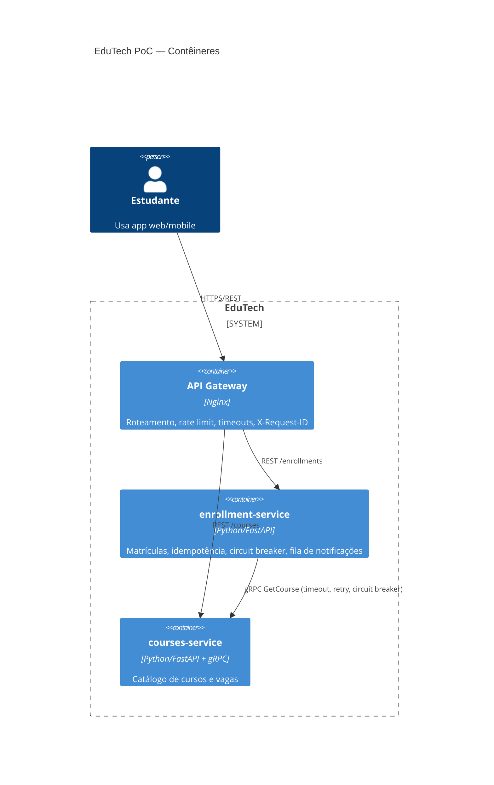
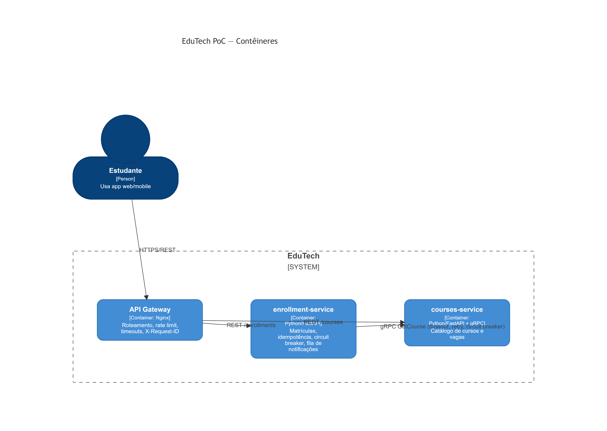

# EduTech PoC — Microsserviços, API Gateway e gRPC (Grupo 1)

Prova de Conceito da disciplina **Arquitetura de Software** (UEPA/CCNT, Profa. MSc Jacqueline Teixeira).
Tema: **Microsserviços & Service Mesh**. Cenário: estudo de caso integrador **EduTech**.

## Integrantes
- Cybele Isabela dos Santos Silva
- Igo Roberth Costa Martins
- Hortencia Gomes Silva
- Lucas Daniel Brito de Queiroz

## O que a PoC demonstra
- Dois microsserviços independentes: `courses-service` (cursos) e `enrollment-service` (matrículas).
- **API Gateway** (Nginx) como ponto único de entrada: roteamento, rate limiting, timeouts e `X-Request-ID`.
- Comunicação **externa em REST** e **interna em gRPC** (`enrollment-service` → `courses-service`).
- **Resiliência**: timeout, retry com backoff exponencial e circuit breaker.
- **Idempotência** na matrícula (header `Idempotency-Key`) e **notificação assíncrona** via fila em memória.

## Como executar
Pré-requisito: Docker com Docker Compose.

```bash
docker compose up -d --build
curl http://localhost:8081/api/courses
curl -X POST http://localhost:8081/api/enrollments \
  -H 'Content-Type: application/json' -H 'Idempotency-Key: abc-1' \
  -d '{"student_id":"igor","course_id":"AS201"}'
```

Demonstração completa (6 cenários, interativa): `./scripts/demo.sh`
Encerrar: `docker compose down`

## Endpoints (via gateway, porta 8081)
| Método | Rota | Descrição |
|---|---|---|
| GET | `/api/courses` | Lista cursos |
| GET | `/api/courses/{id}` | Detalha um curso |
| POST | `/api/enrollments` | Cria matrícula (exige `Idempotency-Key`) |
| GET | `/api/enrollments/{id}` | Consulta matrícula |

Cursos de teste: `ES101`, `AS201`, `BD301` (com vagas) e `LP001` (lotado → HTTP 409).

## Testar resiliência
- **Serviço fora do ar:** `docker compose stop courses-service` e tente matricular → 3 falhas (HTTP 503) abrem o circuito; as seguintes respondem 503 imediatamente. Ao subir o serviço, o circuito fecha sozinho em ~10 s.
- **Serviço lento:** altere `LATENCY_MS: "1500"` no `docker-compose.yml` e rode `docker compose up -d` → o timeout de 1 s dispara retry e, depois, circuit breaker.
- Estado do circuito: `docker compose exec enrollment-service python -c "import urllib.request;print(urllib.request.urlopen('http://localhost:8002/circuit').read().decode())"`

## Diagrama C4 (nível 2 — contêineres)


## Diagrama C4



## Limitações (deliberadas)
Dados em memória (sem banco por serviço), fila de notificações em memória (sem Kafka/RabbitMQ), sem autenticação, sem Service Mesh no Compose (ver seção 6 do relatório para a extensão com Istio em Kubernetes), idempotência sem tratamento de requisições concorrentes com a mesma chave.
