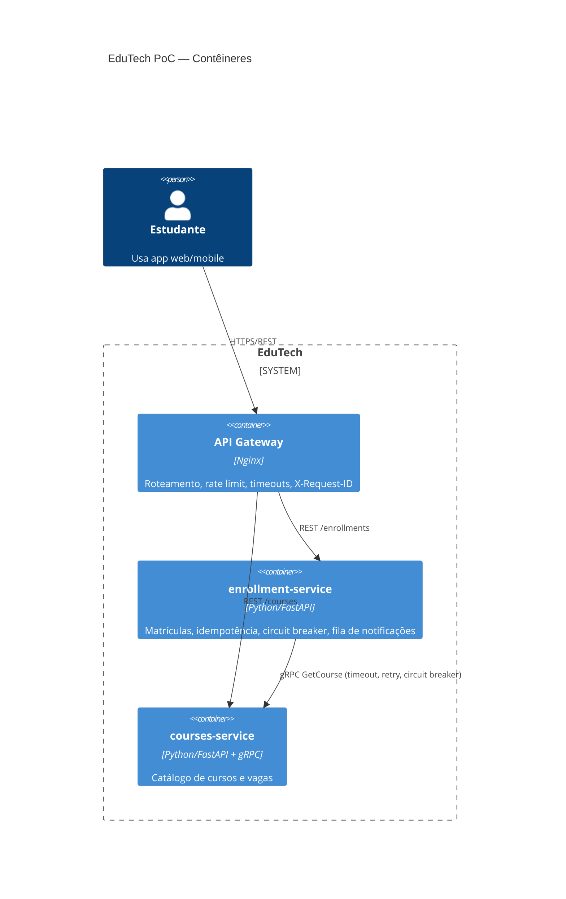

# EduTech PoC — Microsserviços, API Gateway, gRPC e Service Mesh

Prova de Conceito da disciplina **Arquitetura de Software** (UEPA/CCNT, Profa. MSc Jacqueline Teixeira).

O projeto demonstra uma arquitetura baseada em microsserviços para uma plataforma educacional, com comunicação REST e gRPC, resiliência na aplicação e uma extensão de infraestrutura com Kubernetes e Istio.

## Integrantes

- Cybele Isabela dos Santos Silva
- Igo Roberth Costa Martins
- Hortencia Gomes Silva
- Lucas Daniel Brito de Queiroz

## Visão geral da PoC

A aplicação é composta por dois microsserviços independentes:

- **courses-service**: disponibiliza o catálogo de cursos e a consulta de vagas.
- **enrollment-service**: realiza e consulta matrículas, comunicando-se com o serviço de cursos por gRPC.

A solução demonstra:

- **API Gateway (Nginx)** como ponto único de entrada, com roteamento, rate limiting, timeouts e `X-Request-ID`.
- Comunicação externa por **REST** e comunicação interna por **gRPC** (`enrollment-service` → `courses-service`).
- **Resiliência na aplicação**: timeout, retry com backoff exponencial e circuit breaker.
- **Idempotência** na criação de matrículas por meio do header `Idempotency-Key`.
- **Notificação assíncrona** por fila em memória.

## Tecnologias

- Python 3.12, FastAPI e gRPC
- Nginx
- Docker e Docker Compose
- Kubernetes (kind)
- Istio 1.32.0 e Envoy
- Kiali, Prometheus, Grafana e Jaeger

## Como executar a PoC base

Pré-requisito: Docker com Docker Compose.

```bash
docker compose up -d --build
curl http://localhost:8081/api/courses
curl -X POST http://localhost:8081/api/enrollments \
  -H 'Content-Type: application/json' -H 'Idempotency-Key: abc-1' \
  -d '{"student_id":"igor","course_id":"AS201"}'
```

Demonstração completa (6 cenários, interativa): `./scripts/demo.sh`

Encerrar: `docker compose down`

## Endpoints (via gateway, porta 8081)

| Método | Rota | Descrição |
|---|---|---|
| GET | `/api/courses` | Lista cursos |
| GET | `/api/courses/{id}` | Detalha um curso |
| POST | `/api/enrollments` | Cria matrícula (exige `Idempotency-Key`) |
| GET | `/api/enrollments/{id}` | Consulta matrícula |

Cursos de teste: `ES101`, `AS201`, `BD301` (com vagas) e `LP001` (lotado → HTTP 409).

## Testar resiliência na aplicação

- **Serviço fora do ar:** `docker compose stop courses-service` e tente matricular. Após falhas consecutivas, o circuit breaker abre e as chamadas seguintes são rejeitadas rapidamente. Ao subir o serviço novamente, o circuito pode fechar após o período de recuperação.
- **Serviço lento:** altere `LATENCY_MS: "1500"` no `docker-compose.yml` e execute `docker compose up -d` para observar timeout, retry e circuit breaker.
- Estado do circuito: `docker compose exec enrollment-service python -c "import urllib.request;print(urllib.request.urlopen('http://localhost:8002/circuit').read().decode())"`

## Extensão: Kubernetes e Service Mesh com Istio

Além da execução base com Docker Compose, a arquitetura foi implantada em um cluster local **Kubernetes kind**, utilizando **Istio 1.32.0** como Service Mesh. Essa extensão mantém os dois microsserviços e adiciona recursos de infraestrutura para tráfego, segurança, resiliência e observabilidade.

### Recursos configurados

- **Kubernetes (kind):** execução dos microsserviços em Deployments e Services no namespace `edutech`.
- **Injeção de sidecars Envoy:** habilitada no namespace `edutech`, permitindo que o tráfego dos workloads passe pela malha.
- **Istio Ingress Gateway e VirtualService:** exposição das rotas `/api/courses` e `/api/enrollments` por meio do gateway.
- **mTLS STRICT:** política `PeerAuthentication` aplicada ao namespace `edutech`. Após a aplicação, as chamadas da aplicação continuaram funcionando.
- **Políticas de resiliência:** `DestinationRule` para connection pool e outlier detection; timeout e retries configurados na rota de consulta de cursos. O retry foi mantido fora da rota de criação de matrícula para evitar repetição automática de uma operação de escrita.
- **Telemetry:** recurso `Telemetry` no namespace `edutech`, usando o provedor Jaeger e amostragem de 100% para o ambiente de demonstração.

### Observabilidade

Foram instalados e acessados os componentes de observabilidade do Istio:

| Ferramenta | Finalidade | Validação realizada |
|---|---|---|
| **Kiali** | Visualizar a malha, workloads, serviços e tráfego | Serviços e workloads da aplicação visualizados; tráfego entre serviços identificado e configuração mTLS indicada na topologia |
| **Prometheus** | Coletar métricas | Fonte de dados conectada ao Grafana |
| **Grafana** | Consultar métricas e dashboards | Dashboard de serviços do Istio exibiu volume de requisições e taxa de sucesso |
| **Jaeger** | Rastreamento distribuído | Rastreamentos exibidos com spans envolvendo o serviço de matrículas e o serviço de cursos |

No Jaeger, a interface é acessada pelo caminho `/jaeger` quando utilizada a configuração do addon instalada neste ambiente. Os rastreamentos validados mostram chamadas relacionadas à matrícula e à comunicação gRPC com o serviço de cursos.

> **Escopo da validação:** foram verificadas a implantação dos componentes, a comunicação da aplicação com mTLS STRICT aplicado, a visualização de tráfego e métricas e a chegada de rastreamentos ao Jaeger. As políticas de timeout, retry e outlier detection foram aplicadas, mas não foi realizado um ensaio controlado de falha para medir o comportamento de cada política sob carga/falha.

### Acesso local às interfaces

Os comandos abaixo criam encaminhamentos de porta. Execute cada um em um terminal separado e mantenha o terminal aberto enquanto utiliza a interface:

```powershell
kubectl port-forward -n istio-system svc/istio-ingressgateway 8082:80
kubectl port-forward -n istio-system svc/kiali 20001:20001
kubectl port-forward -n istio-system svc/grafana 3000:3000
kubectl port-forward -n istio-system svc/tracing 16690:80
```

Endereços locais:

- Aplicação via Istio Gateway: [http://localhost:8082](http://localhost:8082)
- Kiali: [http://localhost:20001](http://localhost:20001)
- Grafana: [http://localhost:3000](http://localhost:3000)
- Jaeger: [http://localhost:16690/jaeger](http://localhost:16690/jaeger)

As portas locais podem precisar ser alteradas caso já estejam em uso.

## Diagrama C4 (nível 2 — contêineres)



## Diagrama C4


## Limitações

- Os dados dos serviços são mantidos em memória, sem persistência em banco de dados por serviço.
- A fila de notificações é em memória, sem Kafka ou RabbitMQ.
- A PoC não implementa autenticação de usuários.
- O ambiente Kubernetes/Istio é uma extensão local de demonstração; a execução base com Docker Compose não utiliza Service Mesh.
- A idempotência não trata requisições concorrentes com a mesma chave.
